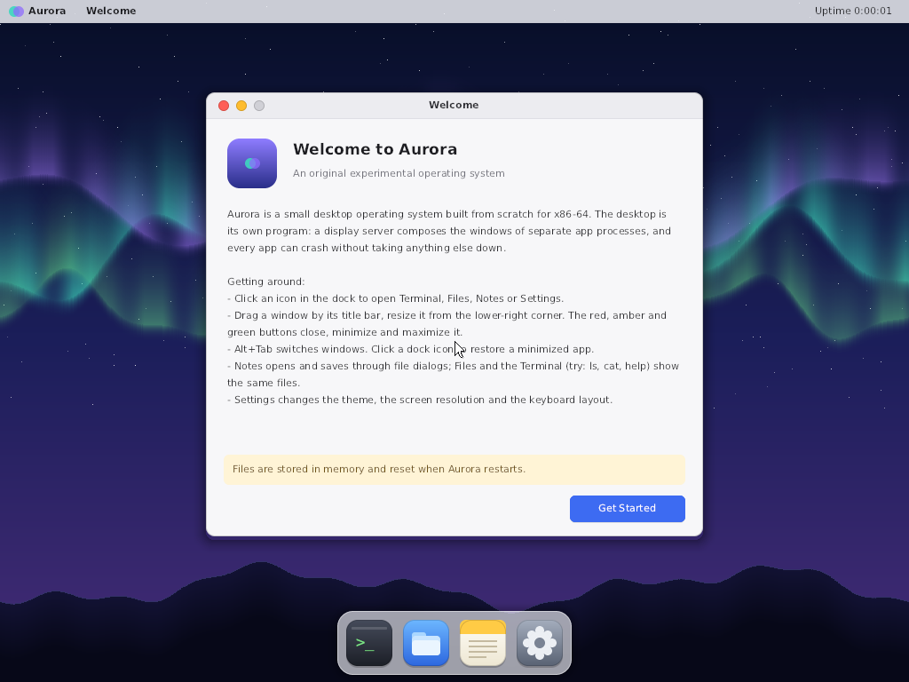
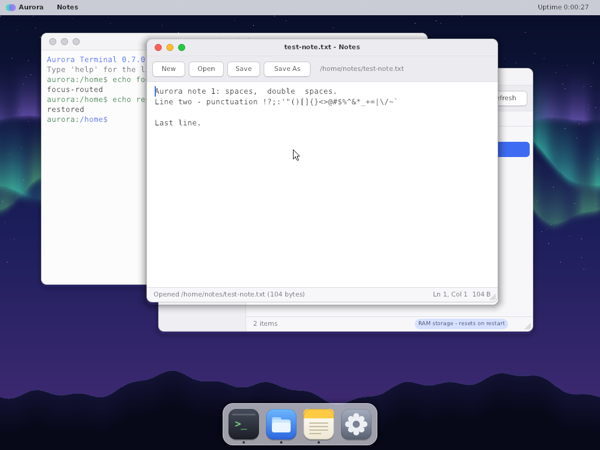
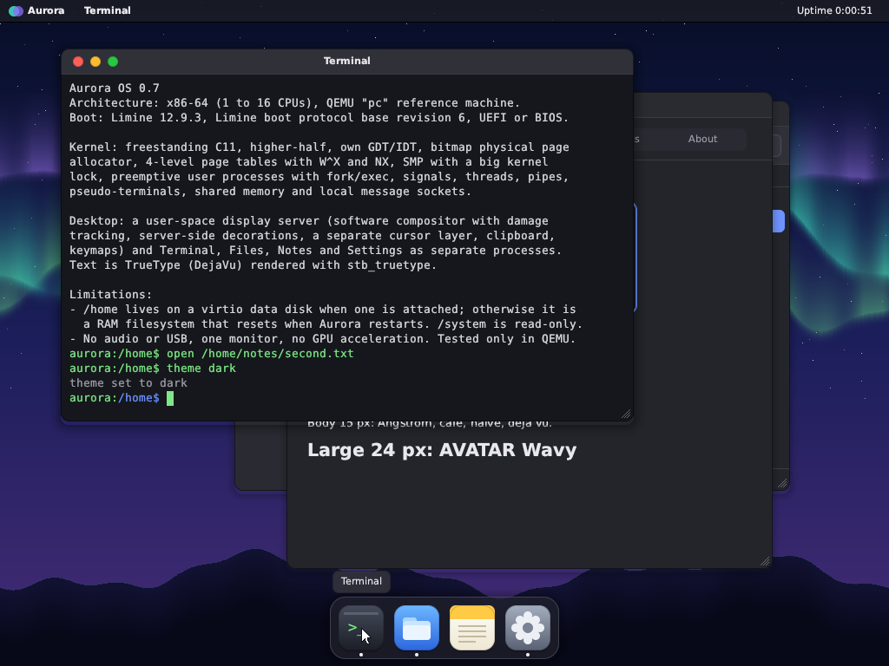
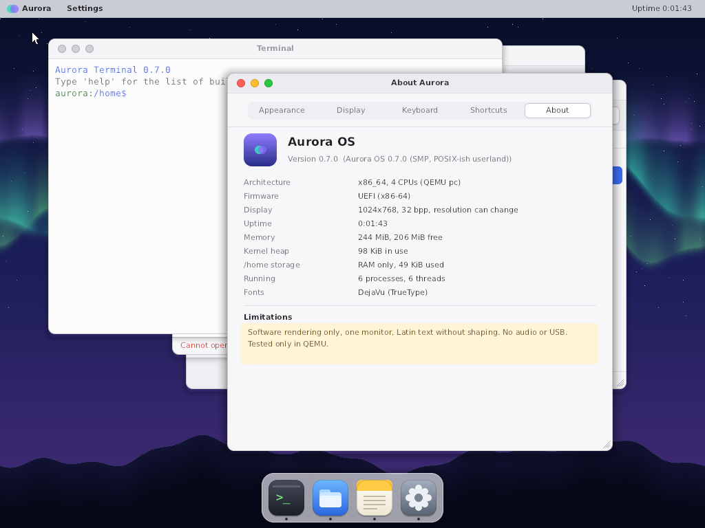
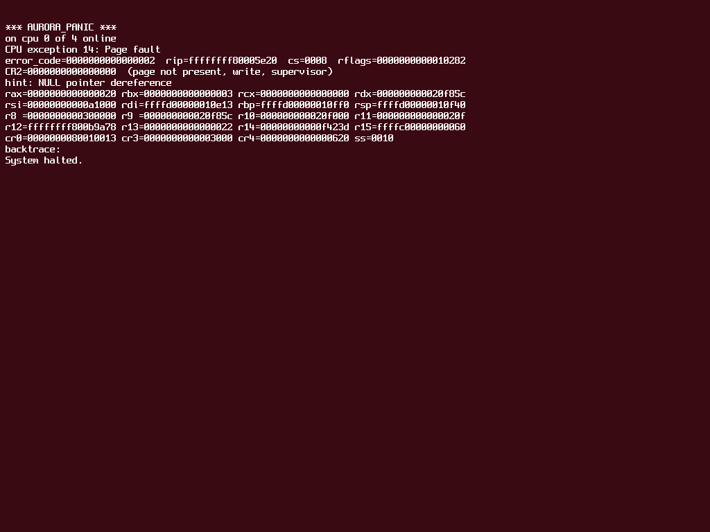
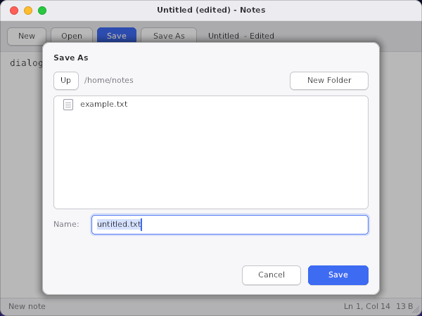
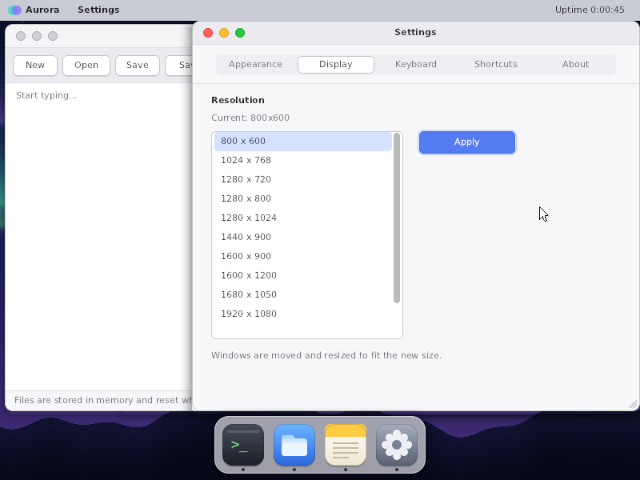

# Aurora OS

Aurora is an original, experimental x86-64 operating system with a calm,
software-rendered desktop. It has its own kernel (memory management,
interrupts, an SMP scheduler for up to 16 CPUs, isolated user processes,
ACPI and APIC support, drivers), a
persistent filesystem on a VirtIO disk, an IPv4/TCP network stack, a
POSIX-ish userland, and a desktop that runs in user space: a display server
(compositor and window manager) and four apps as separate processes,
**Terminal, Files, Notes and Settings/About**, with TrueType text. It boots with the Limine bootloader and runs on emulated
hardware in QEMU.

Aurora is not macOS and has nothing to do with Apple software: it cannot run
macOS (or any other) programs, and all of its artwork is original.



| | |
|---|---|
|  |  |
|  |  |
|  |  |

All screenshots are QEMU `screendump` captures of the guest framebuffer
taken by the automated tests, not mockups.

## Quick start

Requirements: Python 3.8+, LLVM clang + ld.lld (15 or newer), GNU make,
`qemu-system-x86_64` with OVMF/edk2 firmware (bundled with QEMU on Windows;
`apt install ovmf` on Debian/Ubuntu), and network access once, to download the
pinned Limine release. `make test` also needs a host C compiler with a C
library. On Linux, `sh tools/setup.sh` lists anything missing.

```bash
make            # builds build/aurora.img (fetches + verifies Limine 12.9.3 on first run)
make run        # boots it in QEMU (UEFI); serial log on the terminal
```

Without make, use `python tools/build.py build` and `python tools/build.py run`.

The tested QEMU command (`make run` prints it) is:

```bash
qemu-system-x86_64 -machine pc -cpu qemu64,+nx -smp 1 -m 256M -vga std \
  -drive file=build/release/aurora.img,format=raw,if=ide,index=0,media=disk \
  -drive file=build/run/data.img,format=raw,if=none,id=data,cache=writeback \
  -device virtio-blk-pci,drive=data \
  -netdev user,id=n0 -device virtio-net-pci,netdev=n0 \
  -drive if=pflash,format=raw,unit=0,readonly=on,file=<edk2-x86_64-code.fd> \
  -drive if=pflash,format=raw,unit=1,file=build/run/ovmf-vars.fd \
  -serial stdio
```

`build/run/data.img` is a 32 MiB blank file created on first run. Aurora
formats it and keeps `/home` there. Delete it to start over.
`python tools/build.py run --no-disk` keeps `/home` in RAM, and `--no-net`
removes the NIC. Aurora never writes to any disk other than the image files
you pass to QEMU.

`make run SMP=4` (or `python tools/build.py run --smp 4`) boots with four
virtual CPUs; the Terminal's `cpus` command shows what each one is doing.

KVM is not needed. Everything runs under QEMU's software emulation (TCG),
including on arm64 hosts, where the guest is still x86-64 and is emulated.
`make run-bios` boots the same image through SeaBIOS instead. `MEM=512M make
run` changes guest RAM.

In QEMU's default GTK window, click inside it to give the guest the mouse.
**Ctrl+Alt+G** releases the mouse and keyboard grab.

## Using Aurora

* **Dock** (bottom): opens Terminal, Files, Notes, Settings. Clicking it again
  focuses the app, or restores it if minimized. A dot marks running apps.
* **Windows**: drag them by the title bar and resize them with the grip in
  the lower-right corner (each app has a minimum size). Red closes, amber minimizes to the dock, green
  maximizes or restores. Clicking a window raises and focuses it.
* **Menu bar**: the Aurora menu (About, Settings, Welcome Guide, Dark/Light
  Appearance, Restart, Shut Down), the active app's menu (Minimize, Close, Next Window),
  and uptime since boot. This is not a clock.
* **Shortcuts**:
  * Alt+Tab (or Ctrl+Tab): next window
  * Ctrl+W: close window
  * Ctrl+M: minimize
  * Ctrl+1–4: open Terminal, Files, Notes or Settings
  * Notes: Ctrl+S save, Ctrl+Shift+S save as, Ctrl+N new, Ctrl+O open (file dialogs);
    Shift+arrows, mouse drag or double-click select; Ctrl+A/C/X/V
  * Terminal: Ctrl+V pastes the clipboard's first line, Ctrl+C stops the
    running program, Ctrl+D ends its input
* **Terminal**: built-in commands (`help` lists them all), including
  `ls`, `cat`, `echo`, `write`, `mkdir`, `rm`, `mv`, `sync`, `df`, `ps`,
  `kill`, `ifconfig`, `netstat`, `display 1280x800`, `keymap us-intl`,
  `reboot` and `poweroff`. Any program in
  `/system/bin` runs as an isolated user process on the Terminal's
  pseudo-terminal, for example `sh`, `lua`, `grep -n main file.c`,
  `ping 10.0.2.2`, `nslookup example.com` or `fetch http://example.com/`.
  Lines with shell syntax go to `sh`, so `cat notes.txt | grep todo | wc -l >
  count.txt` works directly. Add `&` to run a program in the background.
* **Files**: browses `/home`, `/home/notes`, `/system` and `/`. Double-click
  or Enter opens a folder or a text file (in Notes); Backspace goes up.
* **Notes**: plain-text UTF-8 editor (16 KiB per note). Open and Save As use
  file dialogs (folders, New Folder, a confirmation before overwriting).
  Closing with unsaved changes offers Save, Don't Save and Cancel.
* **Settings**: theme, screen resolution, keyboard layout (US or
  US-International with dead keys: `'` then `e` gives é) and key repeat;
  About shows the running system.
* **Clipboard**: kept by the display server, so text copied in one app can
  be pasted after that app has quit.

With the data disk attached (the default for `make run`), **files in
`/home` are saved to the disk and survive restarts**. Without it they are
stored in memory and reset when Aurora restarts. The apps say which mode is
active. `/system` is read-only.

## What 0.7 is, and is not

* User programs run in ring 3 with their own address spaces and are
  preemptively scheduled. Since 0.7 that includes the desktop: the display
  server and every app are processes, so a crashing app takes nothing else
  down, and if the display server itself dies, init restarts it.
* Programs are portable C compiled on the host (`tools/aurora_cc.py`)
  against newlib and Aurora's POSIX layer: `fork`/`exec`/`posix_spawn`,
  pthreads, pipes, signals, `mmap` (including shared memory), permissions,
  a pty-based terminal, a shell with pipelines, small utilities and Lua 5.4.
  Linking is static; there is no compiler inside Aurora, no job control and
  no Linux binary compatibility.
* The desktop renders in software (one internal pixel format, damage
  tracking); text is DejaVu via stb_truetype, Latin scripts only (no
  shaping or right-to-left). Resolution changes work on QEMU's standard
  VGA; one monitor; no GPU acceleration.
* Networking covers IPv4, ICMP, UDP, DHCP, DNS and a TCP client (no
  server sockets, no congestion control, **no TLS**: `https://` is refused).
* SMP: user programs run in parallel on all CPUs, but most kernel code
  (system calls, files, network) still runs under one big kernel lock, so it
  does not scale yet. There is no AML interpreter: ACPI covers power-off,
  the power button and reset only.
* There is no audio, USB or login.
* It is tested on QEMU's `pc` machine with PS/2 input, the std VGA
  framebuffer and VirtIO disk/NIC only. Real hardware is untested and
  unsupported.

See [STATUS.md](STATUS.md) for the acceptance matrix with evidence and
[docs/roadmap.md](docs/roadmap.md) for what comes next.

## Development

| Command | What it does |
|---|---|
| `make` | release image `build/aurora.img` |
| `make run` / `make run-bios` | interactive QEMU (UEFI / BIOS) |
| `make debug` | QEMU paused with a GDB stub on `tcp::1234`; `gdb build/release/kernel.elf -ex 'target remote :1234'` |
| `make test` | host unit tests (ASan + UBSan when the compiler supports them) |
| `make smoke` | boots the real guest at 128/256/512 MiB (UEFI) and via BIOS, and checks the panic diagnostic |
| `make integration` | drives the real guest with QMP mouse/keyboard input and checks windows, files, limits, processes, resize, clipboard, LEDs and power-off |
| `make storage` | data-disk persistence and crash-consistency tests (hard QEMU kills) |
| `make network` | networking tests against servers started on the host |
| `make smp` | boots at 1/2/4/8 CPUs, per-CPU work, TLB shootdown, ACPI power button, 2-minute 8-CPU stress |
| `make stress` | the 30-minute 8-CPU stress run (0.5 acceptance) |
| `make posix` | 0.6 acceptance: pipelines, Ctrl+C, fork x1000, signals, permissions, Lua test suite |
| `make desktop` | 0.7 acceptance: golden screenshots, 200x150 to 1600x1000 resize, dialogs, clipboard after exit, dead keys, resolution change, killing apps and the display server |
| `make soak` | 4-minute random input and idle soak |
| `make check` | ELF/image consistency checks (non-PIE, higher half, W^X segments, Limine markers, no undefined symbols) |
| `make dist` | `build/dist/aurora-os-0.7.0.zip` with source, image, kernel and docs |
| `make clean` | removes `build/` only |

Build variants: `release`, `test` (adds `@@` serial markers used by the
integration tests, plus the `testfill`, `pfsstress` and `pfscheck` Terminal
commands), and `panic`
(deliberately dereferences NULL after boot).

Documentation: [architecture](docs/architecture.md), [boot](docs/boot.md),
[memory](docs/memory.md), [processes](docs/processes.md), [SMP](docs/smp.md),
[input](docs/input.md), [filesystem](docs/filesystem.md),
[networking](docs/networking.md), [testing](docs/testing.md),
[roadmap](docs/roadmap.md), [decisions](docs/decisions.md), [dependencies](DEPENDENCIES.md).

License: MIT for Aurora's own code. Limine is BSD-2-Clause, `limine.h` is
0BSD, and the Spleen font is BSD-2-Clause.
